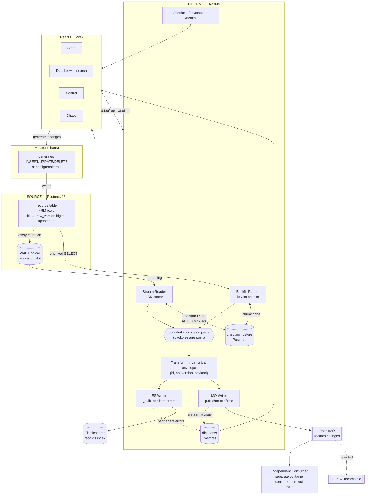

# Implementation Plan — "Kill It Twice"

**Companion to** `00-ASSIGNMENT-DECODED.md`.
**Goal of this doc:** the architecture I recommend, *why* each piece is the way it is, and a 10-day execution order that produces the git history the assignment requires.

---

## 0. TL;DR of the recommendation

| Concern | Choice | One-line reason |
|---|---|---|
| Source DB | **PostgreSQL 16** | logical replication gives a *durable, server-side* change cursor — G1 and lag-metrics come almost free |
| Incremental mode | **Logical replication slot** (`pgoutput` via `pg-logical-replication`) | exact resume by LSN, captures DELETEs, slot lag is a first-class metric |
| Backfill mode | **Keyset-paginated chunks** (`WHERE id > $last ORDER BY id LIMIT n`) | O(1) per chunk, resumable at chunk granularity, no OFFSET death |
| Backfill ⟷ stream conflict | **Version-based last-writer-wins, not DBLog watermarks** | ES `version_type=external` makes stale writes a no-op; removes the hardest part of DBLog |
| Pipeline runtime | **NestJS (TypeScript)** | matches their stack; DI + modules make the gates testable |
| Search sink | **Elasticsearch 8** `_bulk` with per-item error handling | their stack; `_bulk` partial failures *are* G4 |
| Event sink | **RabbitMQ** + publisher confirms + a separate consumer service | their stack; DLX gives a DLQ for free |
| Checkpoints / DLQ | **Postgres (pipeline's own schema)** | must be transactional and durable — Redis is the wrong tool here |
| Metrics | **prom-client → `/metrics`** + a `/api/status` aggregate | G5 needs numbers, not dashboards |
| UI | **React + Vite + TypeScript** | deliberate deviation from their Angular stack — shipping speed on a 10-day clock beats the stack-match signal; **must be an ADR** (see ADR-005, §11.1) |
| Verify | **TypeScript script in a container**, driven by `make verify` | must run on the reviewer's Mac/Linux and your Windows box |

---

## 1. Architecture



ASCII version of the critical path (this is the one that goes in the README, with the two markers they ask for):

```
  Postgres ──chunks──┐
   (table)           ├──► queue ──► transform ──┬──► ES _bulk ──► Elasticsearch
  Postgres ──WAL─────┘   (bounded)              │      │
   (slot)                                       │      └─ per-item permanent error ──► ★DLQ
                                                │
                                                └──► RabbitMQ (confirms) ──► Consumer
                                                       │
                                                       └─ nack/unroutable ──► ★DLQ

  ◆CHECKPOINT written here ─────────────────────────────┘  (only AFTER both sinks ack)
  ★DLQ = Postgres dlq_items + RabbitMQ DLX
```

---

## 2. The one decision everything else hangs off

**Both modes read the same source at the same time.** Backfill is reading row 3,000,000 while the stream delivers an UPDATE to row 3,000,000. Whichever lands last in Elasticsearch wins. If backfill's *stale* copy lands last, the index is now **permanently wrong** — the stream will never re-emit that row.

There are two known fixes:

### Option A — DBLog watermarks (what Netflix/Debezium do)
Write a low watermark to the log, read a chunk, write a high watermark, and drop any buffered chunk row that also appeared in the stream between the watermarks. Correct, elegant, and **expensive to build in 10 days** — you need to write to the source DB and reconcile a windowed buffer.
([Netflix DBLog](https://netflixtechblog.com/dblog-a-generic-change-data-capture-framework-69351fb9099b), [Debezium incremental snapshots](https://debezium.io/blog/2021/10/07/incremental-snapshots/))

### Option B — monotonic row version + version-aware sinks ✅ **recommended**
Give every source row a monotonically increasing `row_version bigint` (a `BEFORE INSERT OR UPDATE` trigger bumping from a sequence). Then:

- **Elasticsearch:** index with `version_type: "external"` and `version: row_version`. ES *rejects* any write whose version is ≤ the stored one, with a per-item `version_conflict_engine_exception`. A stale backfill write becomes a **harmless no-op**, not corruption.
- **RabbitMQ consumer:** keeps `(id → last_version)`; drops anything not newer. Same rule, applied by hand.
- **Deletes:** tombstone with the version, so a late-arriving stale upsert can't resurrect a deleted row (`delete` + a short-lived tombstone row in the consumer's table; in ES use a delete and rely on version bookkeeping — see §7 open questions).

This converts the hardest concurrency problem into **one shared invariant**: *a write only applies if its version is newer than what's stored.* The same invariant then also gives you G2 for free — replayed duplicates after a crash are no-ops.

> **This is ADR-001 and it's the strongest thing in the submission.** Present Option A as the considered alternative with a clear trade-off: watermarks work without touching the source schema; versioning needs a schema change but is 10× less machinery and makes duplicate-tolerance a property of the system rather than a special case.

---

## 3. Data model

### Source (`source` DB)
```sql
-- the thing being replicated: a customer/contact record, because Optio does segmentation
CREATE TABLE records (
  id           BIGSERIAL PRIMARY KEY,
  external_id  UUID NOT NULL,
  email        TEXT,
  full_name    TEXT,
  country      TEXT,
  status       TEXT,                  -- active/churned/trial...
  attributes   JSONB,                 -- ~1KB of segmentation attrs
  created_at   TIMESTAMPTZ NOT NULL,
  updated_at   TIMESTAMPTZ NOT NULL,
  row_version  BIGINT NOT NULL        -- from a global sequence, trigger-maintained
);
CREATE INDEX ON records (row_version);
ALTER TABLE records REPLICA IDENTITY FULL;   -- so DELETEs carry the old row
```

### Pipeline (`pipeline` DB / schema)
```sql
CREATE TABLE backfill_jobs (
  id UUID PRIMARY KEY, status TEXT,            -- pending|running|paused|done|failed
  last_key BIGINT NOT NULL DEFAULT 0,          -- ◆ the G1 checkpoint
  rows_done BIGINT, rows_total BIGINT,
  chunk_size INT, started_at TIMESTAMPTZ, updated_at TIMESTAMPTZ
);

CREATE TABLE stream_checkpoint (
  slot_name TEXT PRIMARY KEY,
  confirmed_lsn TEXT NOT NULL,                 -- ◆ the other G1 checkpoint
  last_commit_ts TIMESTAMPTZ,                  -- → lag = now() - this
  updated_at TIMESTAMPTZ
);

CREATE TABLE dlq_items (
  id UUID PRIMARY KEY,
  sink TEXT NOT NULL,                          -- 'elasticsearch' | 'rabbitmq'
  record_id BIGINT NOT NULL,
  row_version BIGINT NOT NULL,
  op TEXT NOT NULL,                            -- upsert|delete
  payload JSONB NOT NULL,                      -- ★ full doc — replayable without the source
  error_class TEXT NOT NULL,                   -- mapping|too_large|rejected|unroutable|unknown
  error_detail JSONB NOT NULL,                 -- verbatim sink error
  source_mode TEXT, source_offset TEXT,        -- backfill chunk key / LSN
  attempts INT NOT NULL DEFAULT 1,
  status TEXT NOT NULL DEFAULT 'pending',      -- pending|replaying|resolved|discarded
  first_seen_at TIMESTAMPTZ, last_seen_at TIMESTAMPTZ
);
```

**Everything G1/G4 needs is in these three tables.** That is the point — state that must survive `docker kill` lives in Postgres, never in memory, never in Redis.

---

## 4. The checkpoint rule (this is G1 + G2)

```
   WRONG                                 RIGHT
   ─────                                 ─────
   read chunk                            read chunk
   advance checkpoint   ← crash here     write to ES  (wait for ack)
   write to sink          = DATA LOSS    write to MQ  (wait for confirm)
                                         advance checkpoint  ← crash here
                                                              = duplicate
                                                              = absorbed by versioning
```

Write it in the README exactly like that. Then:

> **Declared guarantee: at-least-once delivery, effectively-once application.**
> The pipeline may deliver a record more than once (by design, after a crash). Both sinks apply writes only when `incoming.row_version > stored.row_version`, so re-delivery is a no-op. End state is identical to exactly-once; we do not claim exactly-once *delivery*, which is not achievable across two independent sinks without a distributed transaction.
> ([why](https://www.rabbitmq.com/docs/confirms))

**Dual-sink atomicity:** you cannot atomically write to ES and RabbitMQ. Options: (a) accept it and checkpoint after both ack, replaying both on crash — fine because both are idempotent; (b) transactional outbox. **Take (a)** and make it ADR-002, naming the outbox as the alternative you rejected for complexity.

---

## 5. Gate-by-gate build & test design

### G1 — resume after kill
**Build:** chunked reader; `last_key` updated in the same transaction that records `rows_done`, after sink acks.
**Test (`verify` script):**
1. `make seed` (N rows), start backfill via API.
2. Poll `/api/status` until `rows_done > 300_000`; record `killed_at = rows_done` and `checkpoint = last_key`.
3. `docker kill pipeline` (SIGKILL — not `stop`, no graceful shutdown allowed to save you).
4. `docker compose up -d pipeline`; assert first log line / status shows `resuming from <checkpoint>` and `checkpoint > 0`.
5. Wait for completion; assert `es_count == source_count`.
6. Print `killed at X / resumed at Y, 0 lost`.
**Pitfall:** if you kill too early the checkpoint is 0 and the gate is vacuous. Gate on a minimum `rows_done`.

### G2 — no duplicates
**Build:** the version invariant (§2), ES `_id = record.id`, consumer keyed upsert.
**Test:** run G1's scenario with **3 kills at random points**, plus one kill of the consumer, then compare:
```
source:   SELECT count(*) FROM records
es:       GET /records/_count
consumer: SELECT count(*), count(DISTINCT record_id) FROM consumer_projection
dupes:    messages_received_total - count(DISTINCT record_id)   ← report this, it will be > 0
```
Report **duplicate deliveries > 0 and duplicate stored rows == 0.** That is the honest, correct result and it demonstrates you understand the difference. Also assert a content check: sample 1000 random ids and compare `row_version` in source vs ES.

### G3 — sink outage
**Build:**
- bounded queue (e.g. 20k envelopes) → when full, the backfill reader **stops issuing chunks** and the CDC reader **stops acking LSN** (Postgres retains WAL in the slot — that's your durable buffer).
- ES writer: exponential backoff with jitter, `100ms → 30s` cap, plus a circuit breaker (`open` after k consecutive failures, `half-open` probe every 30s). **Sleep, never spin.**
- health: `sink_up{sink="elasticsearch"} 0` while down.

**Test:**
1. Start continuous sync; confirm throughput > 0.
2. `docker pause elasticsearch` (or `docker compose stop`; pause is more brutal — connections hang rather than refuse, which tests your timeouts).
3. For 60s, sample `docker stats pipeline --no-stream` every 5s → **assert mean CPU < 25%** (this is the anti-busy-loop assertion; pick the threshold after measuring your idle baseline).
4. Assert queue depth metric rises and then plateaus (backpressure working), no OOM, process alive.
5. `docker unpause elasticsearch`; measure time until `sink_up == 1` and throughput recovers → `recovered in X.Xs`.
6. Assert final counts match source. Print `60s down, 0 lost, recovered in X.Xs`.

> Optional upgrade: put **Toxiproxy** in front of ES so you can inject latency and partial failures, not just full outage. Nice-to-have, cut it if time is short.

### G4 — partial batch failure
**Build:** this is the most fiddly piece. Elasticsearch `_bulk` returns **HTTP 200 with per-item errors** — the client does *not* throw, so a naive integration silently drops the failures. ([bulk API](https://www.elastic.co/guide/en/elasticsearch/reference/8.19/docs-bulk.html), [a real-world instance of this exact bug](https://github.com/OpenCTI-Platform/opencti/issues/17134))

```ts
const res = await es.bulk({ operations });
if (res.errors) {
  for (const [i, item] of res.items.entries()) {
    const r = item.index ?? item.create ?? item.update;
    if (!r?.error) continue;
    switch (classify(r.error.type, r.status)) {
      case 'stale':      break;                    // version_conflict → expected no-op, count it
      case 'retryable':  retryBucket.push(ops[i]); break;  // 429, 503, circuit_breaking
      case 'permanent':  dlq.push(ops[i], r.error); break; // mapper_parsing, doc too large
    }
  }
}
// the 497 that succeeded are already committed — never re-send them
```
**Make the poison realistic:** define the ES index with `"dynamic": "strict"` and a typed field (e.g. `attributes.score: integer`). A chaos endpoint writes a row with `score: "not-a-number"` → ES returns `document_parsing_exception` for exactly those items. This is a *genuine* rejection, not a simulated one. (Second, cheaper poison: an oversized doc exceeding `http.max_content_length`.)

**Test:**
1. Insert a 500-row batch containing 3 poisoned rows via the chaos API.
2. Assert `es_count` increased by exactly 497.
3. Assert `dlq_items` has exactly 3 rows with `error_class='mapping'` and a non-empty `payload`.
4. **Replay proof:** call `POST /api/dlq/replay` with a `fix` (or unpoison the source rows), assert they land and DLQ drains to 0. *Replay that isn't tested isn't a replay path.*
5. Print `497 written, 3 in DLQ`.

### G5 — observability
**Build — the exact metric set** (name them after the five questions):
```
pipeline_backfill_rows_done / pipeline_backfill_rows_total / pipeline_backfill_last_key
pipeline_rows_read_total{mode="backfill|stream"}
pipeline_rows_written_total{sink="es|mq"}
pipeline_rows_failed_total{sink,class}
pipeline_throughput_rows_per_second{mode}       # derived, 10s window
pipeline_cdc_lag_seconds                        # now() - last processed commit timestamp
pipeline_cdc_slot_lag_bytes                     # from pg_replication_slots
pipeline_dlq_size{sink}
pipeline_sink_up{sink}
pipeline_queue_depth
pipeline_write_duration_seconds (histogram)
```
Plus `/health` (liveness), `/ready`, and `/api/status` returning one JSON with the five answers. Structured JSON logs (pino) with `mode`, `chunk_key`/`lsn`, `batch_id` on every line.

**Test:** scrape `/metrics`, assert each required metric **exists and is non-degenerate** (throughput > 0 while running, lag is a real number, dlq_size matches the DB count, sink_up == 1, /health == 200). Then assert `/api/status` answers all five. Print the values in the PASS line.

---

## 6. Data volume — and how to argue for it

**Recommendation: 5,000,000 rows, ~1 KB each ≈ 5 GB in Postgres, ~6–8 GB in ES.**

The README argument (they grade this reasoning):

- **Must break "load it all into memory":** 5 GB against a pipeline container capped at **512 MB** makes streaming mandatory, not optional. State that you set the memory limit in `docker-compose.yml` on purpose so the constraint is enforced, not assumed.
- **Must make the gates non-vacuous:** a kill at 3 minutes into an ~8 minute backfill leaves a meaningful, verifiable resume point. With 50k rows the backfill finishes before you can kill it.
- **Must keep `verify` runnable:** at a target ~10k rows/s the full backfill is ~8 min, and the whole verify suite lands around 15–20 min on a laptop. That's the ceiling for something a reviewer will actually run.
- **Must fit a reviewer's machine:** ~15 GB total disk, ES heap 2 GB. Anything larger risks the reviewer's Docker Desktop OOMing — which would be a worse outcome than a smaller dataset.
- **Escape hatch:** `SEED_ROWS` env (default 5M) and `make verify FAST=1` → 500k for a ~3 min smoke run. Document both, and state which one produced the numbers in the README.

Seeding 5M rows fast: `COPY FROM` with a generator (or `INSERT ... SELECT FROM generate_series`), not row-by-row inserts. Target < 3 min for `make seed`.

---

## 7. Open questions to resolve in SPEC v1 (list them as open — that's the point)

1. **Deletes in ES with external versioning.** ES keeps a deleted doc's version only for `index.gc_deletes` (default 60s). A stale upsert arriving later can resurrect the row. Decide: (a) accept the 60s window and document it, (b) raise `gc_deletes`, (c) soft-delete (`deleted: true` flag) instead of real deletes. **Lean (c)** — soft delete is the standard search-index answer and dodges the whole class. Record the decision *and the reasoning* in SPEC.
2. **Backfill and stream both writing the same record concurrently in the same batch** — dedupe within a batch by `max(row_version)` per `id` before sending. Cheap, worth doing.
3. **Replication slot growth** if the pipeline is down for a long time → WAL fills the disk. Add a `slot_lag_bytes` alert threshold and a documented "when to drop and re-backfill" runbook line.
4. **Does the backfill ever end?** Snapshot the max `id` at job start; rows created after that come via the stream. Otherwise backfill chases an ever-growing table forever.
5. **Consumer restart** → does it re-read from the queue or skip? Manual ack after the projection write, same rule as §4.

---

## 8. What to cut (decide now, write it down)

**Cut and document:**
- ClickHouse, S3, NiFi — listed in their stack, not required by the task.
- Auth/multi-tenancy, k8s manifests, TLS, Grafana dashboards (the `/metrics` endpoint + UI cover G5).
- Horizontal scaling of the pipeline — instead write a paragraph in Capacity Notes on *how* you'd shard (by `id % N`, one slot per shard, or partitioned tables) and what breaks.
- Schema evolution / multiple source tables.
- Any "production polish": rate limits, config UI beyond the 3 knobs that matter, pretty charts.

**Cut only if time runs out, in this order:** Toxiproxy → live-updating data table (fall back to polling) → chaos panel refinements → G3's CPU assertion (degrade to "no crash + recovered") → the second poison type.

**Never cut:** the version invariant, the checkpoint ordering, DLQ replay, the five metrics, `make verify` doing its own killing.

---

## 9. Ten-day plan (ordered to produce the right git history)

| Day | Output | Commit shape |
|---|---|---|
| **0 (today)** | `git init`, `SPEC.md v1`, `AGENTS.md v1`, `docs/DEVIATIONS.md` (empty log), `README.md` skeleton. **No code.** | `spec: v1 — scope, invariants, open questions` ← **must be the first commits** |
| **1** | `docker-compose.yml` (pg, es, rabbit, pipeline, consumer, ui), source schema + trigger, `make seed` hitting 5M | `chore: compose skeleton`, `feat(seed): ...` |
| **2** | Backfill reader + ES writer, checkpointing, first end-to-end run | `feat(backfill): keyset chunks + checkpoint` |
| **3** | **G1 test written and passing.** `verify` harness skeleton printing the table. | `test(g1): kill-resume gate` + `spec: v2 — <what v1 got wrong>` |
| **4** | CDC reader (logical replication), lag metric, both modes concurrent | `feat(cdc): pgoutput stream + LSN checkpoint` |
| **5** | RabbitMQ writer + independent consumer + version-idempotent projection. **G2 test.** | `test(g2): duplicate accounting` |
| **6** | Backpressure, backoff, circuit breaker. **G3 test** incl. CPU sampling. | `feat(resilience): bounded queue + backoff`, `test(g3)` |
| **7** | Per-item bulk error handling, DLQ, replay API. **G4 test.** | `feat(dlq): per-item classification + replay`, `test(g4)` |
| **8** | Metrics + `/api/status` + `/health`. **G5 test.** UI panels 1 & 2. | `feat(obs): prometheus metrics`, `test(g5)` |
| **9** | UI panels 3 & 4 (control + chaos). Capacity measurement run. | `feat(ui): control + chaos` |
| **10** | README: diagram, 4+ ADRs, guarantee, capacity notes, "didn't build", **"where AI deviated" (from the live log)**, gate table. `spec: v3 — final state`. Full clean-room run: `git clone && docker compose up && make seed && make verify`. | `docs: README` |

**Two discipline rules for the whole 10 days:**
1. **Every time the agent produces something that contradicts SPEC.md, append to `docs/DEVIATIONS.md` immediately** — what you asked, what it did, why the spec was wrong or under-specified, what you changed. You need ≥2 for the README; you'll naturally get 5–10. Pick the two most interesting.
2. **When you change your mind, commit the SPEC change separately from the code change**, and let the spec commit land first. That's the artifact they're grading.

---

## 10. `AGENTS.md` — what goes in it

Sketch of the sections (write this on day 0, refine as you go):
- **Ground rules:** SPEC.md is the contract; if the code must diverge, stop and propose a SPEC edit first. Never edit `docs/DEVIATIONS.md` (that's the human's log).
- **Layout:** `services/pipeline`, `services/consumer`, `services/ui`, `db/`, `scripts/verify`, `docs/`.
- **Invariants that must never be broken** (spell them out — these are what a coding agent will silently violate):
  - checkpoints advance **only after** sink acknowledgement
  - all sink writes are version-guarded; no unconditional overwrite
  - no unbounded in-memory collection of source rows — ever
  - no `while(true)` without a sleep/backoff
  - `_bulk` responses must be inspected per item; `res.errors` is never ignored
- **Conventions:** TS strict, no `any` at module boundaries, structured logs only, every new failure mode gets a metric.
- **How to verify your own work:** `make verify` must pass before you claim done; `make verify FAST=1` for iteration; adding a feature that touches a gate means updating that gate's test.
- **Out of bounds:** don't touch `docker-compose.yml` resource limits (they're load-bearing for the volume argument), don't add dependencies without asking, don't "fix" a failing gate by weakening its assertion.

---

## 11. Decisions I'd like you to confirm

These change the plan materially. My defaults are in **bold** — say the word if you want different.

1. **UI framework: React + Vite + TypeScript — decided.** Optio lists Angular in their stack, so this is a visible deviation and needs to be defended, not hidden. It costs a small signal and buys ~1–1.5 days that go into gate depth, which the brief weights far higher ("three perfect gates beat five half-done ones"). Write it up as **ADR-005**:
   - *Decision:* React + Vite for the operator UI.
   - *Alternatives:* Angular (stack match with the hiring team); server-rendered templates (no build step, but no live updates); Grafana only (no control or chaos panels, fails UI requirement 3 and 4).
   - *Trade-offs:* loses the stack-match signal and the "can you work in our codebase" reassurance; gains iteration speed on a fixed 10-day budget, and the UI is an operator console for the gates, not a product surface they asked to be production-grade.
   - Keep the UI thin regardless: it is a view over `/api/status` and `/metrics` plus four POST endpoints. **No business logic in the UI** — anything the UI can do must also be doable via the API, because `make verify` drives the API, never the browser.
2. **Pipeline language/framework:** **NestJS/TypeScript** (stack match) vs something you're faster in (Go, Python). Stack match is worth real points here; deviate only if it buys you a gate.
3. **Incremental mode mechanism:** **Postgres logical replication** (harder, much better story: real CDC, deletes, exact resume) vs `updated_at`/`row_version` polling cursor (a day cheaper, but you must explain the missed-update and clock-skew edge cases). If day 4 goes badly, the polling cursor is the documented fallback — and that fallback *is* a great SPEC v2 entry.

---

## 12. ADR slate (README needs ≥4 — plan for 6)

Keep the numbering stable from day 0; each one is *decision · alternatives · trade-offs*.

| # | Decision | Alternatives rejected | Core trade-off |
|---|---|---|---|
| **ADR-001** | Monotonic `row_version` + version-guarded sinks to reconcile backfill vs stream | DBLog/Debezium watermarks; stop-the-world snapshot | needs a source schema change (trigger + column); in exchange, duplicate-tolerance becomes a system property instead of special-case logic |
| **ADR-002** | Checkpoint after both sinks ack; accept replay on crash | transactional outbox; 2PC across ES + RabbitMQ | gives up exactly-once *delivery* (unachievable across two independent sinks) for a far simpler pipeline; safe only because ADR-001 makes replay a no-op |
| **ADR-003** | Postgres logical replication slot for incremental mode | `updated_at` polling cursor; trigger-written changelog table | operationally heavier (slot can fill the WAL disk) but gives exact LSN resume, real DELETEs, and a free lag metric |
| **ADR-004** | DLQ in Postgres with the full payload, not a queue | RabbitMQ DLX as the only DLQ; a dead-letter file | a table is queryable, countable for `dlq_size`, and replayable without the source still holding the row — a DLX alone can't answer "how many and why" |
| **ADR-005** | React + Vite for the operator UI | Angular (their stack); server-rendered templates; Grafana only | loses the stack-match signal; buys ~1–1.5 days redirected into gate depth |
| **ADR-006** | 5M rows with a 512MB pipeline memory cap enforced in compose | smaller dataset; larger dataset | makes "stream, don't buffer" a compile-time constraint rather than a claim, while keeping `make verify` inside ~20 min on a reviewer's laptop |

## Sources

- [DBLog: A Generic Change-Data-Capture Framework — Netflix TechBlog](https://netflixtechblog.com/dblog-a-generic-change-data-capture-framework-69351fb9099b)
- [Incremental Snapshots in Debezium](https://debezium.io/blog/2021/10/07/incremental-snapshots/)
- [Using watermarks to coordinate change data capture in Postgres — Sequin](https://blog.sequinstream.com/using-watermarks-to-coordinate-change-data-capture-in-postgres/)
- [Elasticsearch Bulk API reference](https://www.elastic.co/guide/en/elasticsearch/reference/8.19/docs-bulk.html)
- [Bulk partial failures bypass retries and lose items — OpenCTI #17134](https://github.com/OpenCTI-Platform/opencti/issues/17134)
- [Consumer Acknowledgements and Publisher Confirms — RabbitMQ](https://www.rabbitmq.com/docs/confirms)
- [The Transactional Outbox Pattern with PostgreSQL and RabbitMQ](https://eventuallymaking.io/p/the-transactional-outbox-pattern-with-postgresql-and-rabbitmq)
- [pg-logical-replication (npm)](https://www.npmjs.com/package/pg-logical-replication)
